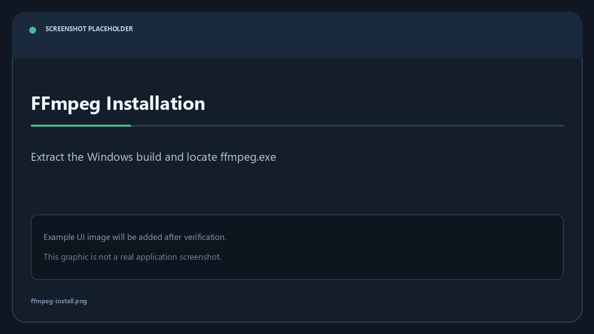
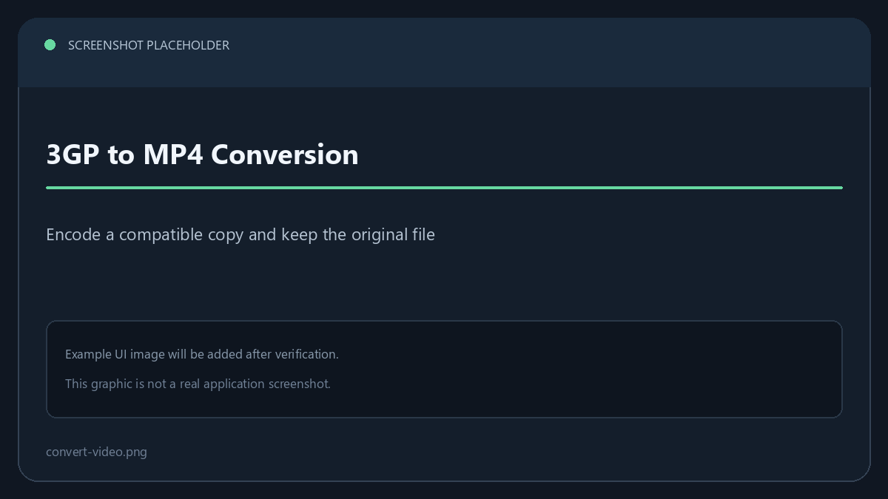
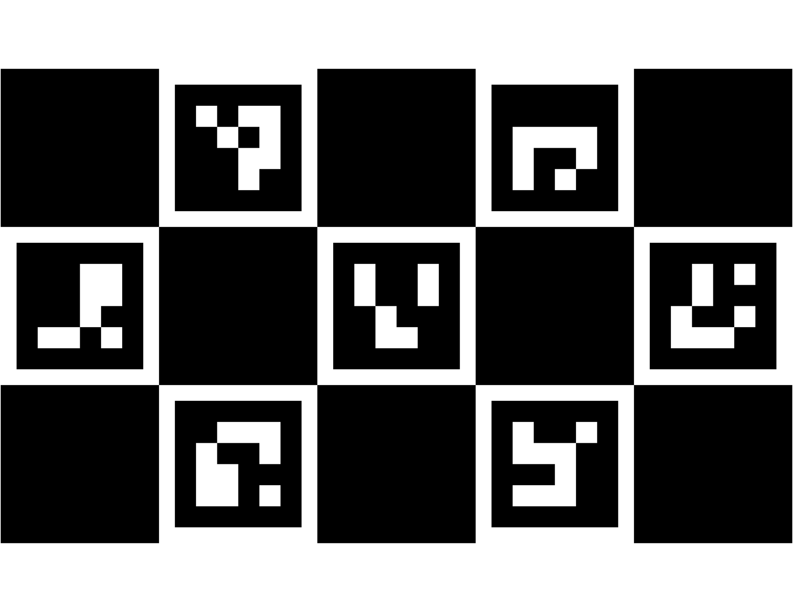
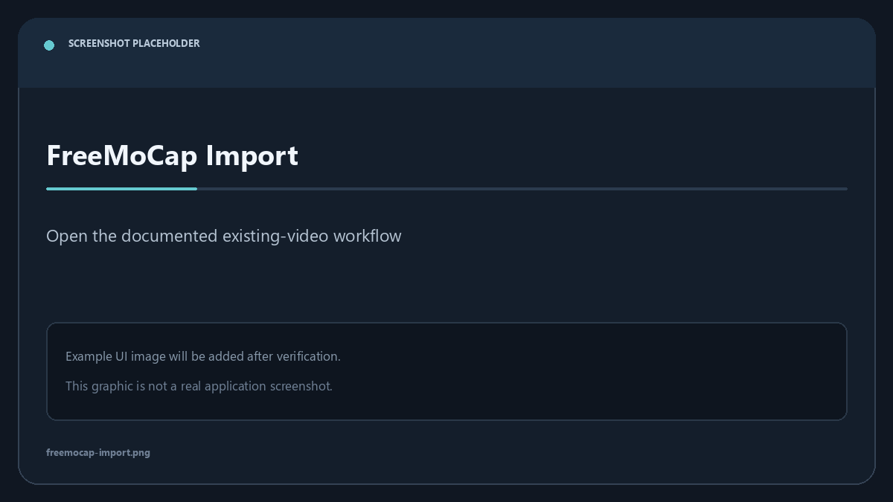
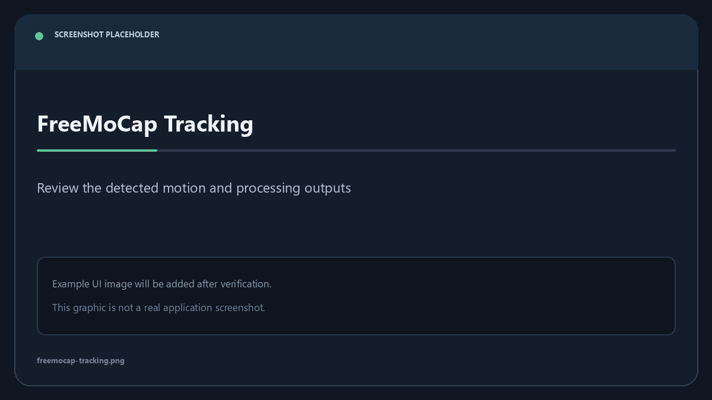
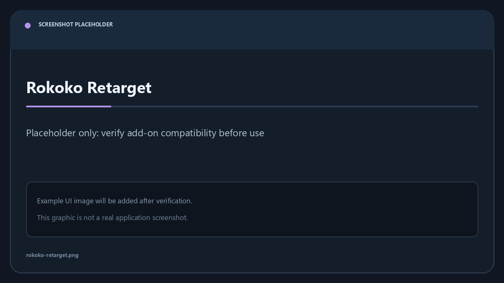

# FreeMoCap + Blender Motion Capture Setup Guide

A beginner-friendly Windows workflow for preparing iPhone video, using FFmpeg when needed, recording and processing motion capture with [FreeMoCap](https://github.com/freemocap/freemocap), and bringing motion into Blender for retargeting to a Mixamo-rigged character.

**[Open the documentation website](https://andrews3dfactory.github.io/FreeMoCap-Mixamo-Blender-Workflow/)** for the interactive guide.

> **Use original footage whenever possible.** Avoid heavily compressed copies. As a practical target, record at 1080p or higher and 30–60 FPS when your iPhone and storage allow it. Better source footage helps, but does not guarantee accurate tracking.
>
> **Version note:** FreeMoCap's interface, supported detectors, filenames, export formats, and Blender integration change over time. UI labels and output examples below are examples reported for this workflow, not guarantees. Follow the documentation and controls for the version you installed. This community guide is not affiliated with FreeMoCap, Apple, FFmpeg, Blender, Adobe Mixamo, or Rokoko.

## Table of contents

- [Workflow at a glance](#workflow-at-a-glance)
- [Before you begin](#before-you-begin)
- [1. Install FFmpeg on Windows](#1-install-ffmpeg-on-windows)
- [2. Add FFmpeg to Windows PATH](#2-add-ffmpeg-to-windows-path)
- [3. Convert a 3GP video to MP4](#3-convert-a-3gp-video-to-mp4)
- [4. Create and record a calibration video](#4-create-and-record-a-calibration-video)
- [5. Record a good iPhone motion video](#5-record-a-good-iphone-motion-video)
- [6. Import video into FreeMoCap](#6-import-video-into-freemocap)
- [7. Process and verify motion data](#7-process-and-verify-motion-data)
- [8. Generate Blender-compatible data](#8-generate-blender-compatible-data)
- [9. Import motion into Blender](#9-import-motion-into-blender)
- [10. Retarget motion to a Mixamo rig](#10-retarget-motion-to-a-mixamo-rig)
- [Troubleshooting](#troubleshooting)
- [Current project status](#current-project-status)
- [References](#references)

## Workflow at a glance

```text
iPhone video → (optional) FFmpeg conversion → FreeMoCap import and processing
   → supported Blender export → inspect motion → retarget to Mixamo armature
```

Calibration is relevant to multi-camera reconstruction and coordinate alignment; it is not required for every single-camera test. See [calibration](#4-create-and-record-a-calibration-video) and the [official FreeMoCap documentation](https://freemocap.github.io/documentation/index_md.html).

[Next: prerequisites](#before-you-begin) · [Jump to the project status](#current-project-status)

## Before you begin

- A Windows computer with enough disk space for original video and generated session data.
- [FreeMoCap](https://github.com/freemocap/freemocap), installed using the current [official documentation](https://freemocap.github.io/documentation/index_md.html).
- [Blender](https://www.blender.org/download/) in a version supported by your FreeMoCap export workflow.
- A Mixamo-rigged character that you are allowed to use.
- For calibration, the exact ChArUco board layout and dimensions selected by your FreeMoCap installation. Board dimensions in this guide are examples, not universal settings.
- FFmpeg only if your video needs conversion or your installed FreeMoCap version does not accept its original format.

Keep the original iPhone video unchanged. Converting a copy is a compatibility step, not a way to restore detail lost to low resolution or compression.

[Back to table of contents](#table-of-contents)

## 1. Install FFmpeg on Windows

1. Open the [official FFmpeg download page](https://ffmpeg.org/download.html) and follow its Windows links to a reputable Windows build provider. Windows builds are maintained by third parties, not by the FFmpeg project itself.
2. Choose the Windows Essentials build if available from the provider you selected. Build names and packaging can change.
3. Extract the downloaded archive to `C:\ffmpeg`.
4. Confirm that these files exist:

```text
C:\ffmpeg\bin\ffmpeg.exe
C:\ffmpeg\bin\ffprobe.exe
```

Open Command Prompt (`Windows key + R`, type `cmd`, press Enter) and verify:

```bat
where ffmpeg
ffmpeg -version
```

If `where ffmpeg` cannot find the executable, continue to [Add FFmpeg to PATH](#2-add-ffmpeg-to-windows-path).



[Back to table of contents](#table-of-contents) · [Next: configure PATH](#2-add-ffmpeg-to-windows-path)

## 2. Add FFmpeg to Windows PATH

PATH lets you run `ffmpeg` from any working folder.

1. Press the Windows key and search for **Edit the system environment variables**.
2. Open **Environment Variables**.
3. Under **System variables**, select **Path**, then choose **Edit**. (You can instead edit your user Path if you do not have permission to change system variables.)
4. Choose **New**, enter the folder containing `ffmpeg.exe`, for example:

```text
C:\ffmpeg\bin
```

5. Confirm the dialogs. Close and reopen Command Prompt; terminals already open do not automatically reload PATH.
6. Verify:

```bat
where ffmpeg
ffmpeg -version
```

Expected `where` output includes:

```text
C:\ffmpeg\bin\ffmpeg.exe
```

[Back to table of contents](#table-of-contents) · [Next: convert a video](#3-convert-a-3gp-video-to-mp4)

## 3. Convert a 3GP video to MP4

**Conversion is optional** if your FreeMoCap version supports the original iPhone video. Prefer the original file to avoid unnecessary quality loss. If you do need to convert, use Command Prompt and replace the example filename with your own:

```bat
ffmpeg -i "C:\Users\YourName\Downloads\Your-File-Name.3gp" -c:v libx264 -preset medium -crf 18 -pix_fmt yuv420p -c:a aac "C:\Users\YourName\Downloads\Your-File-Name_FreeMoCap.mp4"
```

`-crf 18` is a quality/size tradeoff (lower values generally mean higher quality and larger files); it cannot improve a low-resolution or already-compressed source. The command creates a new MP4 and leaves the input in place. Keep the original and use the new MP4 only if needed.

Check that FFmpeg can read the converted file:

```bat
ffmpeg -i "C:\Users\YourName\Downloads\Your-File-Name_FreeMoCap.mp4"
```

If the source has no audio stream, FFmpeg may print an audio-related warning; video conversion can still be usable. See [conversion troubleshooting](docs/troubleshooting.md#ffmpeg-cannot-find-or-convert-a-video).



[Back to table of contents](#table-of-contents) · [Next: calibration](#4-create-and-record-a-calibration-video)

## 4. Create and record a calibration video

Calibration setup depends on whether you use one camera or multiple cameras and on the FreeMoCap version. A single-camera experiment may not require calibration. For multi-camera capture, use the [current official FreeMoCap calibration instructions](https://freemocap.github.io/documentation/index_md.html).

### Prepare the ChArUco board

1. Obtain the ChArUco board image specified by your FreeMoCap installation or its documentation.
2. Print it at the intended scale; do not use **Fit to page** or **Scale to fit** if the procedure requires exact dimensions.
3. Attach it to a rigid, flat backing.
4. Set the board layout and square/marker dimensions in FreeMoCap to match the physical print exactly.

For example, a **7 × 5 board with 58 mm squares** may appear in a particular setup, but this is not a universal FreeMoCap requirement. Do not copy those example dimensions unless they match the board and settings you actually use.



### Record and process calibration

1. Place each camera in its intended capture position. Secure the cameras and do not move them after calibration.
2. In FreeMoCap, open the calibration recording workflow available in your installed version.
3. Record the board visible to the cameras. Slowly move and tilt it through the usable image area while keeping the whole board in view. Follow the duration and motion prompts in the current app; exact steps vary by release.
4. Select the calibration recording and run its calibration action. UI text may differ; treat labels such as **Calibrate** as examples.
5. Confirm the application reports success before relying on the calibration.
6. If using a ground-plane option, follow the version-specific instructions. Some FreeMoCap ground-plane workflows require the board to begin flat, still, and visible to all cameras for several seconds. A label such as **Align to Initial Charuco Ground Plane** is not guaranteed to appear in every release.

Calibration can help establish camera geometry and coordinate orientation; it does not guarantee a particular body scale or tracking quality. If calibration fails, check [board and camera troubleshooting](docs/troubleshooting.md#calibration-fails).

[Back to table of contents](#table-of-contents) · [Next: record movement](#5-record-a-good-iphone-motion-video)

## 5. Record a good iPhone motion video

Use the original iPhone camera recording whenever possible. Practical capture guidance:

- Record at 1080p or higher and 30–60 FPS when supported and practical for storage. 4K is optional, not necessary for every workflow.
- Keep the entire body, hands, and feet in frame throughout the movement.
- Use a stable camera support, good even lighting, and a simple background.
- Wear clothing that contrasts with the background; avoid motion blur and limbs hidden behind the body.
- Keep the phone's orientation steady and transfer the original file without messaging-app recompression.
- A subject-camera distance of roughly 8–15 feet can be a useful starting point when the room and framing allow it; ensure the full body remains large and clear enough in frame.

Avoid very low-resolution or low-frame-rate sources (for example 176 × 144 at 10 FPS) and heavily compressed copies when possible. Converting such a file to MP4 does not restore missing image detail.

[Back to table of contents](#table-of-contents) · [Next: import into FreeMoCap](#6-import-video-into-freemocap)

## 6. Import video into FreeMoCap

FreeMoCap's interface and support for importing existing videos vary by version. Use the corresponding workflow in the [current FreeMoCap documentation](https://freemocap.github.io/documentation/index_md.html).

1. Open FreeMoCap and choose the workflow for a new recording or processing existing video.
2. If your installed version exposes **Playback** and **Import Videos**, those may be the relevant controls; exact labels are version-dependent.
3. Select the original video if supported. Otherwise, select the MP4 copy created in [Step 3](#3-convert-a-3gp-video-to-mp4).
4. For multi-camera processing, import the synchronized camera videos for one session and use the matching calibration. A single iPhone clip is suitable for a single-camera test; independently recorded clips are not automatically synchronized.
5. Confirm the recording appears in the application's session/recordings list and that the video is readable before continuing.



**Screenshot coming soon:** replace this illustration with a verified FreeMoCap import screenshot.

[Back to table of contents](#table-of-contents) · [Next: process and verify](#7-process-and-verify-motion-data)

## 7. Process and verify motion data

Select the imported recording and continue through the processing workflow exposed by your installed version. Labels such as **Continue to Mocap Setup**, **Process Recording**, **Run Pipeline**, or **Start Processing** are examples from particular workflows, not guaranteed UI text.

1. Choose a detector and settings supported by your installation.
2. Start the processing run and wait for it to finish. Do not close the app while it is working.
3. Look for its completion status and review the resulting motion for missing frames, jumps, or implausible tracking.
4. Open the recording's output folder using the path shown in FreeMoCap. One reported example is `C:\Users\jakee\freemocap_data\recordings`; your configured data directory can differ.

Generated files depend on the FreeMoCap version and selected detector. Files such as `output_data`, `rtmpose_body_3d_xyz.npy`, `rtmpose_skeleton_3d.npy`, `rtmpose_left_hand_3d_xyz.npy`, `rtmpose_right_hand_3d_xyz.npy`, or `rtmpose_face_3d_xyz.npy` are examples only—not a required or guaranteed output list. Do not conclude processing failed solely because a differently named set of files was produced.



**Screenshot coming soon:** replace this illustration with a verified FreeMoCap tracking screenshot.

[Back to table of contents](#table-of-contents) · [Next: Blender data](#8-generate-blender-compatible-data)

## 8. Generate Blender-compatible data

Use the Blender export supported by the exact FreeMoCap release and detector you used. Upstream FreeMoCap currently contains an integrated Blender exporter that documents MediaPipe output support; this may change, and processing support does not necessarily mean export support.

1. Continue to the export stage or choose the Blender export control provided in the installed version. Labels such as **Generate Blender Scene**, **Export to Blender**, **Blender Export**, or **Create Blender File** are examples, not universal UI labels.
2. If requested, select the installed Blender executable and any release-compatible export options.
3. Note the output location and verify that the expected file was created. Depending on the supported workflow, output might be a `.blend` scene or an exchange format such as `.fbx` or `.bvh`. These are examples from possible workflows, not formats guaranteed to be produced by every FreeMoCap release.
4. If the export is unavailable, check the selected detector, Blender detection, and the documentation for that release.

Raw FreeMoCap skeleton or marker data is not automatically a Mixamo-compatible animation. Use a documented exporter or a retargeting path that supports the actual source data.

[Back to table of contents](#table-of-contents) · [Next: inspect in Blender](#9-import-motion-into-blender)

## 9. Import motion into Blender

Open a generated `.blend` file directly, or import an exchange format only when it was actually produced and is documented by your export workflow.

1. Launch a compatible Blender version and open the exported scene.
2. For BVH, use Blender's version-appropriate **File → Import → Motion Capture (.bvh)** menu if available.
3. For FBX, use **File → Import → FBX (.fbx)** if available.
4. Verify the imported armature/skeleton and scrub the timeline to confirm motion is present.
5. Check scale, orientation, frame range, and motion before saving a separate working copy.

Menu names and built-in import support vary across Blender versions. A motion-capture skeleton appearing in the scene does not mean it is already retargeted to a Mixamo character.

[Back to table of contents](#table-of-contents) · [Next: retarget to Mixamo](#10-retarget-motion-to-a-mixamo-rig)

## 10. Retarget motion to a Mixamo rig

The target character in this workflow is already rigged in Mixamo. Retargeting maps the source skeleton's motion onto the target character's armature; bone names, rest poses, and axes may differ.

1. Save a copy of the Blender project before retargeting.
2. Confirm both the source motion and Mixamo-rigged character are imported and cover the intended timeline.
3. Choose a retargeting tool whose current documentation supports your Blender version and source/target rigs. Rokoko Studio Live Blender Add-on is one possible tool to investigate, not a guaranteed compatible or required choice. Verify current compatibility and the tool's requirements before relying on it.
4. Map corresponding source joints to the Mixamo deform bones, set rest/reference pose and axes, and adjust scale/root motion as required by the chosen tool.
5. Bake or otherwise save the retargeted action to the character armature using the tool's documented procedure.
6. Play the full animation and inspect feet, knees, elbows, root drift, and frame range. Fix mapping or scale issues and save the final scene.

```text
FreeMoCap motion → supported export → Blender source skeleton
    → compatible retargeting workflow → Mixamo armature → character animation
```



**Screenshot coming soon:** replace this illustration with a verified retargeting screenshot.

[Back to table of contents](#table-of-contents) · [Need help? Troubleshooting](#troubleshooting)

## Troubleshooting

| Problem | First check |
|---|---|
| FFmpeg not found | Run `where ffmpeg`; verify PATH contains the `bin` folder with `ffmpeg.exe`, then reopen Command Prompt. |
| FreeMoCap cannot read the video | Use the original if supported; otherwise convert a copy to H.264 MP4 and keep the original. |
| Poor tracking | Use original 1080p+ / 30–60 FPS footage when practical, improve lighting, and keep the full body visible. |
| Calibration fails | Match the physical board to configured layout/dimensions; keep it visible and cameras fixed; follow version-specific ground-plane steps. |
| Unexpected output filenames | Check the version and detector. Example `rtmpose_*` outputs are not universal. |
| No Blender scene/export | Confirm the export supports the selected detector and installed Blender version; inspect FreeMoCap's message. |
| Motion will not retarget | Check source and target bone mapping, rest pose, axes, scale, and compatibility of the chosen add-on. |

See the detailed [troubleshooting guide](docs/troubleshooting.md) for commands and further checks.

[Back to table of contents](#table-of-contents) · [Return to the workflow](#workflow-at-a-glance)

## Current project status

The checkmarks below reflect the **user-reported status** supplied for this project; they have not been independently re-run or verified in this documentation task.

- [x] FFmpeg installed.
- [x] FFmpeg added to PATH.
- [x] Video successfully converted.
- [x] FreeMoCap successfully imported video.
- [x] FreeMoCap successfully generated tracking data.
- [x] Calibration board available.
- [ ] Create calibration recording.
- [ ] Run calibration.
- [ ] Record high-quality motion capture video.
- [ ] Generate Blender scene.
- [ ] Import motion into Blender.
- [ ] Retarget motion to Mixamo character.
- [ ] Bake final animation.

## References

- [FreeMoCap source repository and releases](https://github.com/freemocap/freemocap)
- [FreeMoCap documentation](https://freemocap.github.io/documentation/index_md.html)
- [FFmpeg download page](https://ffmpeg.org/download.html)
- [Blender downloads and manual](https://www.blender.org/download/)
- [Mixamo](https://www.mixamo.com/)
- [Creative Commons Attribution 4.0](https://creativecommons.org/licenses/by/4.0/)

[Back to table of contents](#table-of-contents)
