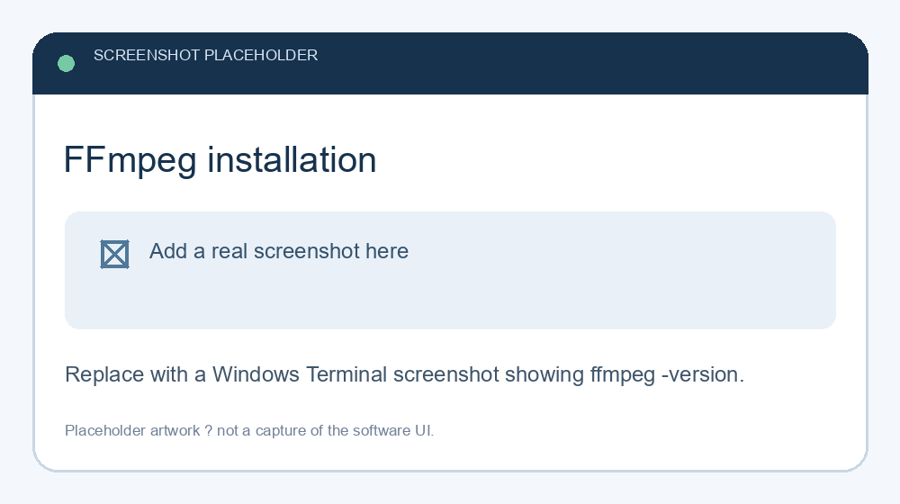
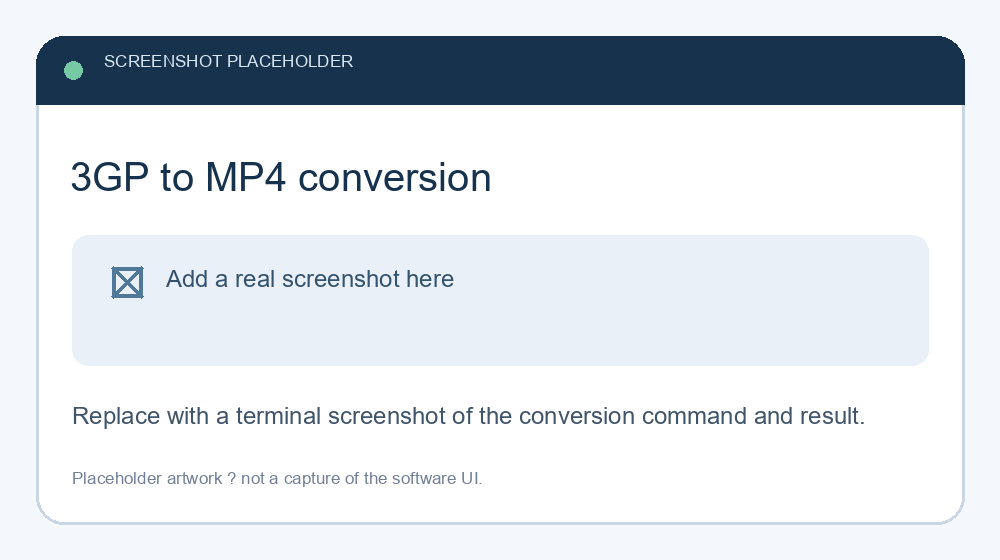
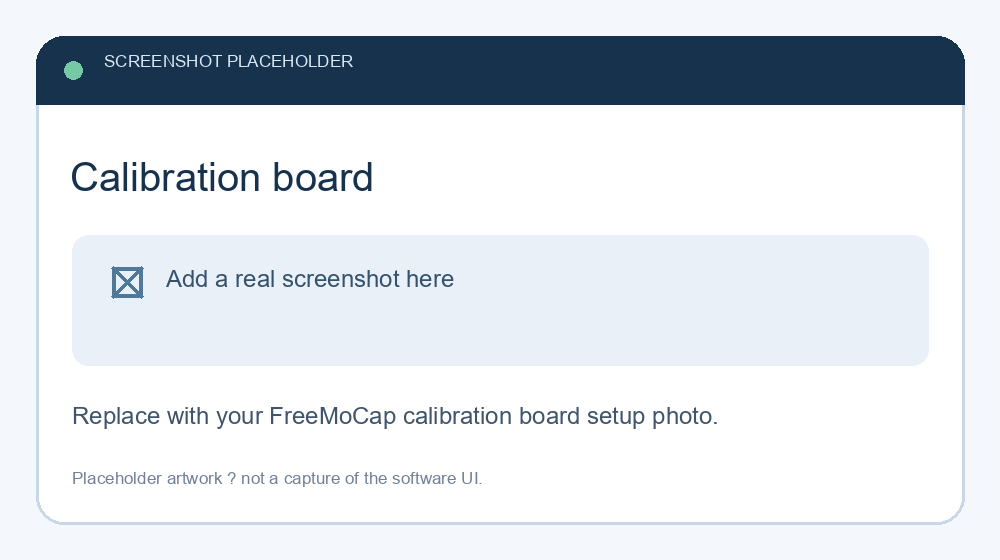
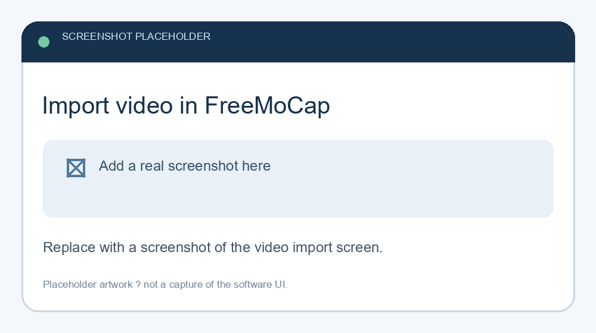
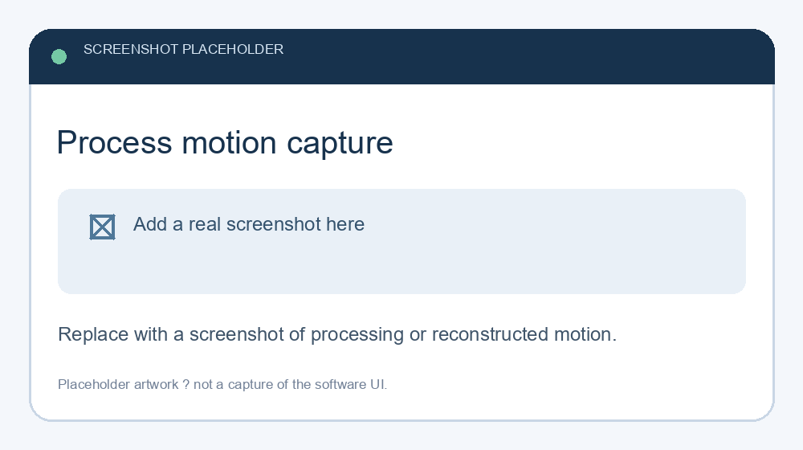
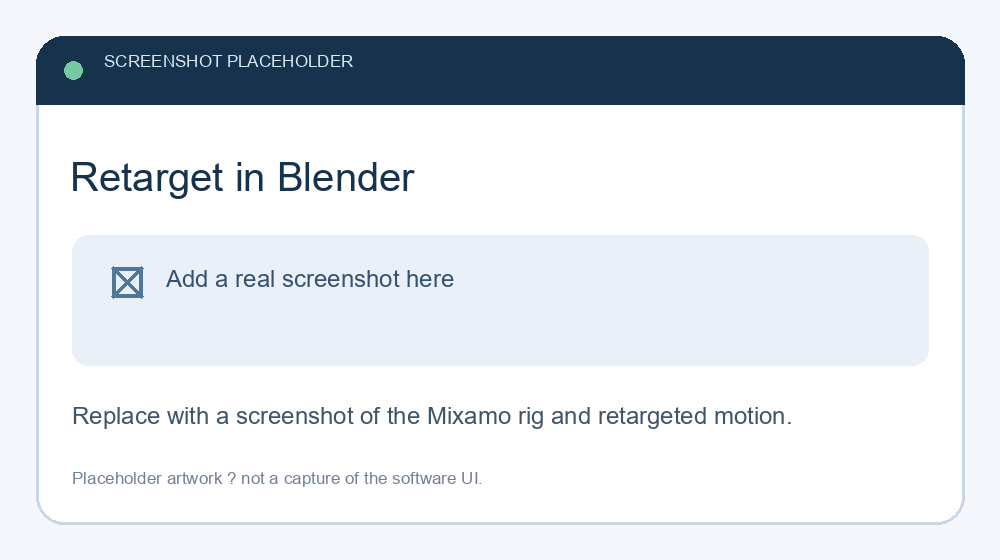

# FreeMoCap → Mixamo → Blender Workflow

A beginner-friendly Windows guide to turn iPhone video into a 3D motion-capture animation and retarget it onto a Mixamo-rigged character in Blender.

> **At a glance:** convert video if needed → record calibration and motion footage → process it in FreeMoCap → export motion data → retarget it in Blender.

**Project status:** 🟡 Community guide in progress. Software interfaces and export options can change between releases. See the [status checklist](#project-status) and [troubleshooting guide](docs/troubleshooting.md).

## Table of contents

- [What you'll need](#what-youll-need)
- [Workflow overview](#workflow-overview)
- [1. Install FFmpeg on Windows](#1-install-ffmpeg-on-windows)
- [2. Add FFmpeg to PATH](#2-add-ffmpeg-to-path)
- [3. Convert 3GP to MP4](#3-convert-3gp-to-mp4)
- [4. Record FreeMoCap calibration footage](#4-record-freemocap-calibration-footage)
- [5. Record motion capture with an iPhone](#5-record-motion-capture-with-an-iphone)
- [6. Import videos into FreeMoCap](#6-import-videos-into-freemocap)
- [7. Process motion capture data](#7-process-motion-capture-data)
- [8. Generate Blender-compatible motion data](#8-generate-blender-compatible-motion-data)
- [9. Import motion into Blender](#9-import-motion-into-blender)
- [10. Retarget onto a Mixamo character](#10-retarget-onto-a-mixamo-character)
- [Troubleshooting](#troubleshooting)
- [Project status](#project-status)
- [Credits and license](#credits-and-license)

## What you'll need

- A Windows 10 or 11 computer with enough free disk space for video and motion-capture files.
- An iPhone capable of recording video, a stable tripod or phone mount, and a well-lit space.
- [FreeMoCap](https://freemocap.org/) installed by following its [official installation guide](https://freemocap.github.io/documentation/).
- [Blender](https://www.blender.org/download/) installed.
- A Mixamo-compatible character. Review [Adobe Mixamo](https://www.mixamo.com/) for its current availability and terms.
- [FFmpeg](https://ffmpeg.org/) only if you need to convert a source video format such as 3GP.

> **Compatibility note:** FreeMoCap and Blender change over time. Prefer the official documentation for the version you have installed. Labels, supported input formats, export options, and Blender workflows may differ from the examples here.

[Back to table of contents](#table-of-contents)

## Workflow overview

1. Install FFmpeg and make it available from a new terminal.
2. Convert a 3GP clip to MP4 only if FreeMoCap cannot read the original.
3. Capture calibration footage and a separate, clear motion clip.
4. Create a FreeMoCap session and import the footage using the app's documented workflow.
5. Process the recording, inspect the result, and export supported motion data.
6. Bring the motion data into Blender and retarget it to the target character's rig.

**Navigation:** [FFmpeg setup](#1-install-ffmpeg-on-windows) · [Capture footage](#4-record-freemocap-calibration-footage) · [FreeMoCap](#6-import-videos-into-freemocap) · [Blender](#9-import-motion-into-blender) · [Troubleshooting](#troubleshooting)

[Back to table of contents](#table-of-contents)

## 1. Install FFmpeg on Windows

FFmpeg is a command-line utility for reading, converting, and writing audio/video. This guide uses a trusted Windows package manager when available. Choose **one** installation method.

### Option A — winget

Open **Windows Terminal** or **PowerShell** and run:

```powershell
winget install --id Gyan.FFmpeg.Shared --exact
```

Follow any prompts. Close and reopen the terminal after installation so it reloads environment variables. If winget cannot find the package, use the official [FFmpeg download page](https://ffmpeg.org/download.html) and its linked Windows builds; avoid unknown download sites.

### Option B — download a Windows build

1. Open [FFmpeg's download page](https://ffmpeg.org/download.html) and follow its Windows build links.
2. Download a current Windows build from the linked provider.
3. Extract the archive to a stable location, for example `C:\ffmpeg`.
4. Confirm that the `bin` folder contains `ffmpeg.exe`, for example `C:\ffmpeg\bin\ffmpeg.exe`.
5. Follow [Add FFmpeg to PATH](#2-add-ffmpeg-to-path).

Check whether FFmpeg is available:

```powershell
ffmpeg -version
```

If PowerShell says the command is not recognized, continue to [Add FFmpeg to PATH](#2-add-ffmpeg-to-path), then open a **new** terminal.



[Next: Add FFmpeg to PATH →](#2-add-ffmpeg-to-path) · [Back to table of contents](#table-of-contents)

## 2. Add FFmpeg to PATH

PATH lets Windows find programs by name without typing their full location. Add the directory containing `ffmpeg.exe` (usually the `bin` directory), not the `ffmpeg.exe` file itself.

### Recommended: Windows Environment Variables settings

1. Open **Start**, search for **Edit the system environment variables**, and open it.
2. Select **Environment Variables…**.
3. Under **User variables**, select `Path`, then **Edit…**. If it does not exist, select **New…** and name it `Path`.
4. Select **New** and enter the actual FFmpeg `bin` folder, such as `C:\ffmpeg\bin`. If you used winget, locate its installed `bin` folder rather than copying this example.
5. Select **OK** in each dialog. Open a new PowerShell window.

Verify both commands:

```powershell
where.exe ffmpeg
ffmpeg -version
```

`where.exe` should print the path to `ffmpeg.exe`; the version command should print build information. Do not remove or overwrite existing PATH entries.

[Previous: Install FFmpeg](#1-install-ffmpeg-on-windows) · [Next: Convert 3GP to MP4 →](#3-convert-3gp-to-mp4) · [Back to table of contents](#table-of-contents)

## 3. Convert 3GP to MP4

Keep the original file and convert a copy. In PowerShell, change the example paths to the actual input and output locations. Quotes are important when a path contains spaces.

```powershell
ffmpeg -i "C:\Videos\walk.3gp" -c:v libx264 -pix_fmt yuv420p -c:a aac "C:\Videos\walk.mp4"
```

FFmpeg prints progress in the terminal. The command finishes when it returns to the PowerShell prompt. Check that the MP4 exists and plays before importing it. If the clip has no audio, FFmpeg may report that no audio stream was found; use this video-only version:

```powershell
ffmpeg -i "C:\Videos\walk.3gp" -c:v libx264 -pix_fmt yuv420p -an "C:\Videos\walk.mp4"
```

If you see an overwrite prompt, choose a new output filename or remove the old output yourself after confirming it is no longer needed. For a batch of files, convert one clip first and verify the result before automating anything.



[Previous: PATH setup](#2-add-ffmpeg-to-path) · [Next: Record calibration footage →](#4-record-freemocap-calibration-footage) · [Back to table of contents](#table-of-contents)

## 4. Record FreeMoCap calibration footage

Calibration helps FreeMoCap estimate the camera or scene geometry required by the capture workflow. Follow the [official FreeMoCap calibration instructions](https://freemocap.github.io/documentation/) for your installed release; supported camera arrangements and calibration-board requirements can vary.

1. Prepare the calibration board or other calibration target specified by the FreeMoCap guide. Print it at the required scale; do not resize it with “fit to page” unless the instructions explicitly allow that.
2. Make sure the board is flat, rigid, fully visible, and evenly lit. Avoid glare, shadows, motion blur, and focus changes.
3. Record the board using the camera arrangement required by the workflow. Move it through the instructed positions and orientations so the target is visible across the capture volume.
4. Keep each camera stationary during a calibration recording unless the official procedure says otherwise.
5. Review the footage before importing it. Confirm the whole target is visible and recognizable throughout the clip.
6. Run calibration as directed in the FreeMoCap documentation and check for a successful calibration result before recording a subject.



[Next: Record iPhone motion footage →](#5-record-motion-capture-with-an-iphone) · [Back to table of contents](#table-of-contents)

## 5. Record motion capture with an iPhone

For an initial test, use one steady, well-positioned iPhone view and a simple action such as standing, walking, or raising both arms. If your FreeMoCap setup supports multiple synchronized cameras, follow its multi-camera instructions; a single view can lose body parts when they are occluded.

1. Place the phone on a tripod or stable mount. Frame the full body, including hands and feet, with some space around the subject.
2. Use a bright, evenly lit area and a background with enough contrast from clothing. Avoid strong backlighting, flicker, and patterned shadows.
3. Keep the camera fixed. Clean the lens, lock focus/exposure if your camera app permits it, and avoid digital zoom.
4. Wear fitted, contrasting clothing. Keep long hair and loose fabric from covering joints. Avoid carrying objects that hide the hands or torso.
5. Start recording before moving. Stand in the capture area, pause briefly, perform the action at a natural pace, then pause before stopping.
6. Keep the entire action in frame and avoid crossing arms or turning completely away from the camera unless that is part of the test.
7. Transfer the original clip to the computer without reducing its resolution. Convert it with [FFmpeg](#3-convert-3gp-to-mp4) only if needed.

### Capture checklist

- [ ] Full body stays in frame for the entire take.
- [ ] The scene is bright and sharp, without obvious motion blur.
- [ ] The phone remains still and the recording plays on the computer.
- [ ] The subject is visually distinct from the background.
- [ ] The action has a clear start and stop with brief still pauses.

[Previous: Calibration](#4-record-freemocap-calibration-footage) · [Next: Import footage →](#6-import-videos-into-freemocap) · [Back to table of contents](#table-of-contents)

## 6. Import videos into FreeMoCap

FreeMoCap terminology and import screens may vary by release. Follow the [official FreeMoCap documentation](https://freemocap.github.io/documentation/) and use the app's session/capture workflow for your version.

1. Launch FreeMoCap and create or select a session using the interface's documented workflow.
2. Choose the supported video or recording import option. Select the calibration recording when requested, then select the motion-capture video(s).
3. Confirm the video files load and that the preview shows the entire subject. Keep source files in a stable location while processing.
4. Review the selected camera count, frame range, and any calibration/session options before starting processing.
5. If import fails, check [Troubleshooting](docs/troubleshooting.md#freemocap-cannot-import-a-video).



[Previous: Record footage](#5-record-motion-capture-with-an-iphone) · [Next: Process motion data →](#7-process-motion-capture-data) · [Back to table of contents](#table-of-contents)

## 7. Process motion capture data

1. Start the processing workflow from the FreeMoCap interface using the settings recommended by the documentation for your release.
2. Allow processing to finish; video processing can take several minutes or longer depending on clip length, resolution, hardware, and camera count.
3. Inspect the 2D detections and reconstructed 3D motion in the available viewers. Check for missing limbs, identity swaps, jitter, and implausible depth.
4. If the result is poor, improve lighting/framing or calibration and process a short test clip again. Do not assume a conversion to MP4 can restore detail missing from the original recording.
5. Save or retain the session outputs in the session's documented location. Keep a backup of source videos and calibration data.



[Previous: Import videos](#6-import-videos-into-freemocap) · [Next: Export Blender-compatible data →](#8-generate-blender-compatible-motion-data) · [Back to table of contents](#table-of-contents)

## 8. Generate Blender-compatible motion data

Use the export supported by your installed FreeMoCap version. The project provides motion data and workflows that have evolved; available formats and any integrated Blender export can depend on release and tracking backend. Check the [official FreeMoCap documentation](https://freemocap.github.io/documentation/) and the installed application's export options rather than assuming a particular file extension or a one-click export.

1. In the processed session, find the export or post-processing options documented for your release.
2. Select a Blender-compatible export or the documented intermediate format for the Blender workflow.
3. Choose an output folder you can find again. Include the session name in the folder or filename.
4. Confirm the export completes and note its format and units. Do not rename an export to another extension to “convert” it.
5. If the FreeMoCap release offers no compatible export for the tracking mode you used, consult the official docs/issues for a supported route before proceeding.

Before moving to Blender, confirm you have the exported motion data and know which import procedure applies to that format.

[Previous: Process data](#7-process-motion-capture-data) · [Next: Import into Blender →](#9-import-motion-into-blender) · [Back to table of contents](#table-of-contents)

## 9. Import motion into Blender

The correct import method depends on the export format and FreeMoCap release. Follow the export's official instructions. If it specifies a Blender add-on, install the add-on only from the source linked by the project and use the install steps for your Blender version. Do not run a Python file from an unknown source.

1. Start Blender and save a new project file.
2. Install or enable the supported importer/add-on if the export documentation requires one.
3. Use the import method specified for the exported format. Select the file or session output created in [the export step](#8-generate-blender-compatible-motion-data).
4. Set the scene frame rate and scale/units as described by the exporter. If the importer provides no unit information, consult its documentation before scaling the character.
5. Scrub the timeline to confirm the imported motion is present and oriented correctly. Save a copy before making retargeting changes.

[Previous: Export motion data](#8-generate-blender-compatible-motion-data) · [Next: Retarget motion →](#10-retarget-onto-a-mixamo-character) · [Back to table of contents](#table-of-contents)

## 10. Retarget onto a Mixamo character

Retargeting maps motion from one skeleton to another. FreeMoCap tracking landmarks are not automatically identical to a Mixamo character's bone hierarchy. The mapping method depends on the exported skeleton and the Blender tools supported by your versions.

1. Obtain a character that you are permitted to use and that has a Mixamo-compatible rig. Download it from the applicable source and follow that source's current license and usage terms.
2. Import the character into Blender using the documented import format. Save a backup copy of the project.
3. Confirm the source motion skeleton and target rig are both present, correctly oriented, and scaled consistently.
4. Use a supported retargeting add-on or documented manual bone-mapping workflow compatible with your Blender version. Map corresponding hips, spine, head, arms, and legs; verify bone names and rest pose rather than relying on a universal mapping.
5. Set the source and target rest poses as required by the retargeting tool. Adjust root alignment and scale before baking or applying the retargeted animation.
6. Preview the entire animation. Check foot sliding, joint twisting, floor penetration, and range of motion. Make corrections to mapping or offsets, then save a new project version.
7. Export or render only after reviewing the character's motion from multiple views.



> **Troubleshooting:** If the character moves in the wrong direction or joints twist, revisit [Blender retargeting issues](docs/troubleshooting.md#blender-retargeting-looks-wrong) and confirm source/target rest pose, bone mapping, and units.

[Previous: Import into Blender](#9-import-motion-into-blender) · [Next: Troubleshooting →](#troubleshooting) · [Back to table of contents](#table-of-contents)

## Troubleshooting

Start with the [detailed troubleshooting guide](docs/troubleshooting.md). Common first checks:

| Symptom | First check |
|---|---|
| `ffmpeg` is not recognized | Reopen PowerShell; confirm PATH points to the folder containing `ffmpeg.exe`. |
| Converted clip is missing or won't play | Verify the input path and review FFmpeg's terminal output. Try a video-only conversion if the source has no audio. |
| FreeMoCap import fails | Confirm the video plays, uses a supported format, and is stored in a readable local folder. |
| Body tracking is incomplete | Improve lighting and framing; keep the whole body visible and review calibration. |
| Blender motion or retargeting is wrong | Confirm the importer, units, axes, rest pose, and bone correspondence for your exact export/rig. |

[Read all troubleshooting steps →](docs/troubleshooting.md) · [Back to table of contents](#table-of-contents)

## Project status

This checklist tracks the documentation workflow, not a guarantee of compatibility for every software version.

- [x] Outline the Windows FFmpeg → FreeMoCap → Blender workflow.
- [x] Add command examples, navigation, beginner guidance, and troubleshooting.
- [x] Add screenshot placeholder files and their README references.
- [x] Add CC BY 4.0 license text.
- [ ] Replace placeholders with screenshots captured from the current software versions.
- [ ] Test the end-to-end workflow against current FreeMoCap and Blender releases.
- [ ] Record tested software versions and update version-specific UI instructions.

**Contributions welcome:** open an issue or pull request with the software versions and steps you verified.

[Back to table of contents](#table-of-contents)

## Credits and license

Documentation in this repository is made available under the [Creative Commons Attribution 4.0 International License](LICENSE). Please attribute this guide when sharing or adapting it. FreeMoCap, Blender, FFmpeg, Adobe Mixamo, and other product names and marks belong to their respective owners; this project is community documentation and is not affiliated with or endorsed by those organizations.

[Back to table of contents](#table-of-contents)
